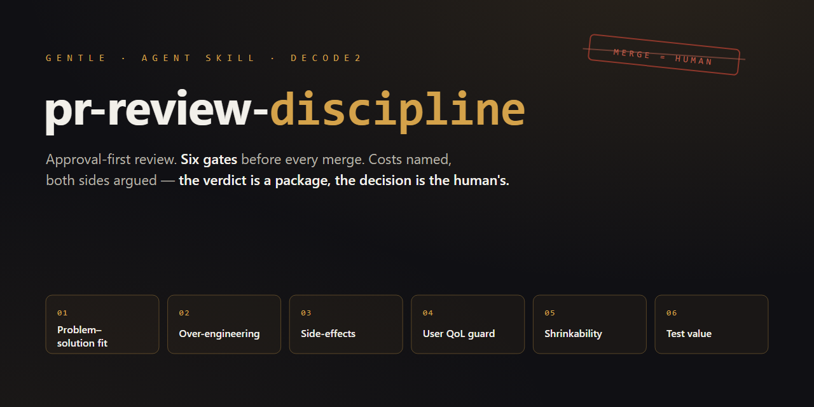

# pr-review-discipline



An AI agent skill for disciplined pull-request review and merge decisions.

Every merge decision runs a six-fold evaluation (problem–solution fit, over-engineering, side-effects, user QoL guard, shrinkability, test value) plus an evidenced cost balance — handed to the human as a pros/cons package. The merge decision is always the human's.

For repositories that run an issue-first workflow (for example, Gentleman Programming repos), two optional gates also apply: issues get an explicit human approval before implementation, and open community PRs are reviewed before opening your own. The skill detects whether the repo works that way (`status:approved` labels, CONTRIBUTING or PR-template rules, outside contributors) and skips those gates in private or single-maintainer repos, saying so in its output.

## Install

```bash
npx skills add decode2/pr-review-discipline
```

## Structure

```
skills/pr-review-discipline/
├── SKILL.md                              # runtime instruction contract
└── references/
    └── six-fold-evaluation.md            # full pre-merge methodology
```

## What it enforces

- Approval precedes work (optional) — in issue-first repos, no self-approving your own issue to unblock your own PR.
- Community PRs before own PRs (optional) — in repos with outside contributors, review and coordinate there first.
- Judge the solution, never the CI — green checks are necessary, never sufficient.
- No fix may create a worse product — QoL regressions are argued or reverted.
- Every fix lands at its smallest honest shape — shrink requests are hunks-named.
- Tests must earn their place — tests per the repo's criteria, each proving a real case of the change; ritual TDD tests are named and fixed.
- Every verdict is a balanced, costed package — reasons FOR and AGAINST, costs on system/user/product axes, and a proposed better way on reject.

## Compatibility

The skill instructions are written in English, and the agent replies in the user's language: ask in Spanish and the evaluation, verdict package, and questions come back in Spanish, following the same rules. Triggers include English and Spanish phrasings ("audit a PR", "review this diff", "auditar PR", "fijate este cambio").

Designed for the Gentle skill format (Activation Contract, Language Contract, Workflow Detection, Hard Rules, Decision Gates); works in Gentle Shell and any agent runtime that loads `SKILL.md` skills. Pairs naturally with `systemic-issue-triage` (root-class grouping, over-engineering gate) and `branch-pr` (mechanical PR creation after these gates pass).

## License

Apache-2.0
